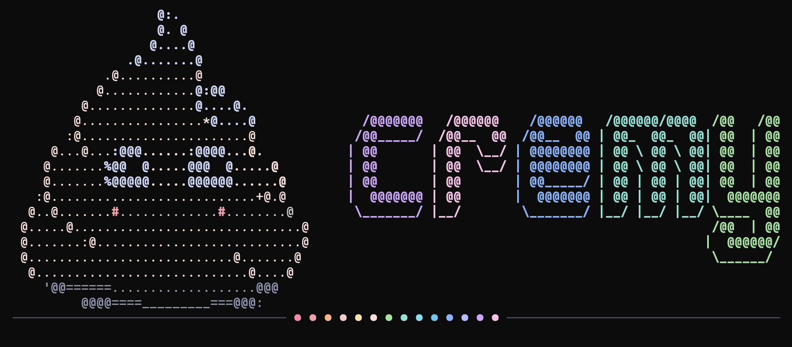

# Cremy



Cremy es una herramienta de línea de comandos (CLI) que te permite interactuar con la API de Ollama. Con ella, puedes realizar consultas a modelos de IA instalados localmente y obtener las respuestas en formato Markdown.

## Tabla de Contenidos

1. [Instalacion](#-instalacion)
2. [Otras guias](#-otras-guias)
3. [Configuración y uso](#-configuracion-y-uso)

## Instalación

Clonar el repositorio:

```bash
git clone https://github.com/Jorge-Marco5/Cremy.git
cd Cremy
```

### Opción 1: Usando `uv` (Recomendado)

Si tienes [uv](https://docs.astral.sh/uv/) instalado, puedes crear el entorno virtual e instalar las dependencias automáticamente con:

```bash
uv sync
```

Para ejecutar la herramienta con `uv`:

```bash
uv run main.py --help
# O usando el script del proyecto directamente:
uv run Cremy --help
# O mediante el script de inicio rápido:
./run.sh --help
```

### Opción 2: Usando `pip` tradicional

```bash
python3 -m venv .venv
source .venv/bin/activate
pip install -r requirements.txt
```

## Otras Guias

[**1. Tools**](./docs/tools.md)

## Configuracion y uso

> **Nota:** Todos los ejemplos a continuación pueden ejecutarse anteponiendo `uv run` (ej. `uv run main.py <accion>` o `uv run Cremy <accion>`), usando `./cremy <accion>`, o directamente con `python main.py <accion>` si ya activaste el entorno virtual (`.venv`).

- ### Comandos de ayuda general

  Para ver lista de acciones dentro del programa

  ```bash
  uv run main.py --help
  # ó tambien
  uv run main.py -h
  ```

  Tambien ayuda de una accion en especifico

  ```bash
  uv run main.py <accion> --help
  # Ejemplo
  uv run main.py change_model --help
  ```

- ### Configurar direccion del host

  Por defecto la heramienta se conecta a una direccion local (localhost), si desea cambiar la direccion:

  ```
  python main.py change_host -u <tu ip o host:puerto>
  # Ejemplo
  python main.py change_host -u http://192.168.1.2:11434
  ```

- ### Ver modelos disponibles y sus capacidades

  Muestra una tabla detallada con todos los modelos instalados en tu host de Ollama, incluyendo cantidad de parámetros, nivel de cuantización, tamaño en disco, tamaño de ventana de contexto y sus capacidades detectadas (👁️ Visión / Multimodal, 🧠 Razonamiento / Thinking, 🛠️ Tools, 💻 Código, 💬 Texto):

  ```
  python main.py models
  ```

- ### Cambiar modelo de IA por defecto

  Cambia el modelo de IA por defecto a uno que tengas instalado en la plataforma de ollama dentro de tu servidor

  ```
  python main.py change_model -m <tu-modelo>
  # Ejemplo
  python main.py change_model -m qwen3.5:9b
  ```

- ### Realizar una pregunta rapida al modelo

  Realizar una pregunta rapida al modelo de ia y te retorna una respuesta sin tener una conversacion o guardar contexto

  ```
  python main.py req ↩️

  Usuario: Escribe tu pregunta
  ---
  # Ejemplo
  python main.py req ↩️
  
  Usuario: ¿Por que el cielo es azul?
  ```

  **Incluir un modelo en especifico**

  Puedes usar un modelo especifico diferente al default siempre y cuando esté instalado en tu servidor

  ```
  python main.py req -m <tu-otro-modelo> ↩️

  Usuario: Escribe tu pregunta
  ---
  # Ejemplo
  python main.py req -m <gemma4:12b> ↩️

  Usuario: ¿Porque el cielo es azul?
  ```

- ### Iniciar una conversacion con un modelo de IA

  Inicia una conversacion con un modelo de IA de forma persistente en el sistema en el cual el modelo puede trabajar en base a el contexto de la conversacion

  ```
  python main.py chat ↩️

  Usuario: Escribe tu pregunta
  ---
  # Ejemplo
  python main.py chat ↩️
  
  User: ¿Por que el cielo es azul?
  ```

  **Incluir un modelo en especifico**

  Puedes usar un modelo especifico diferente al default siempre y cuando esté instalado en tu servidor
  - solo puedes cambiar el modelo saliendo del chat e ingresando nuevamente seleccionando la conversacion en la que estabas trabajando

  ```
  python main.py chat -m <tu-otro-modelo> ↩️
  
  Usuario: Escribe tu pregunta
  ---
  # Ejemplo
  python main.py chat -m <gemma4:12b> ↩️

  Usuario: ¿Por que el cielo es azul?
  ```

- ### Seleccionar una conversacion

  Continua una conversacio anterior
  - las conversaciones se guardan iniciando una solicitud como _chat_, no como _req_

  ```
  python main.py resume

  Seleccione una conversación
  > 223752fb-b75f-481f-ad8e-a79c848a550c - crea un hola mundo en python
  ```

  **Incluir un modelo en especifico**

  Puedes usar un modelo especifico diferente al default siempre y cuando esté instalado en tu servidor

  ```
  python main.py resume -m <tu-otro-modelo>
  # Ejemplo
  python main.py resume -m <gemma4:12b>
  ```

- ### Eliminar una conversacion

  Selecciona una conversacion guardada para eliminarla completamente

  ```
  python main.py delete_chat

  Seleccione una conversación
  > 223752fb-b75f-481f-ad8e-a79c848a550c - crea un hola mundo en python
  ```

- ### Agregar system prompt personalizado

  Cambia el system prompt del modelo de IA por defecto a uno personalizado que se ajuste a tus necesidadesde trabajo

  ```
  python main.py system_prompt -t <tu-system-prompt>
  # Ejemplo
  python main.py system_prompt -t 'Actua como un ingeniero de software util, experto en programación '
  ```

- ### Activar/Desactivar modo razonamiento

  Activa o desactiva el modo razonamiento del modelo de IA por defecto

  ```
  python main.py think
  ```

- ### Ver metricas de uso

  Puedes ver estadisticas generales de uso como tokens y tiempo general de uso ordenados de forma descendente en base a el mayor consumo de tokens

  ```
  python main.py metrics -m <tu-modelo>
  # Ejemplo
  python main.py metrics -m <qwen3.5:9b>
  ```

- ### Configurar y personalizar opciones del modelo (Ollama Options)

  Puedes personalizar parámetros de inferencia de Ollama (temperatura, ventana de contexto, muestreo, etc.) de forma persistente o mediante flags por petición:

  **Ver opciones configuradas y parámetros soportados:**
  ```
  python main.py options
  ```

  **Configurar una opción persistente:**
  ```
  python main.py set_option -k <clave> -v <valor>
  # Ejemplos:
  python main.py set_option -k temperature -v 0.2
  python main.py set_option -k num_ctx -v 8192
  python main.py set_option -k top_p -v 0.9
  ```

  **Restablecer opciones a los valores por defecto:**
  ```
  python main.py reset_options
  ```

  **Sobreescribir opciones en una consulta específica (`req` o `chat`):**
  ```
  python main.py req -t 'Explica la teoría de la relatividad' --temperature 0.3 --num-ctx 4096
  python main.py chat -t 'Hola' --temperature 0.9
  ```

- ### Soporte de Modelos Multimodales (Imágenes y Visión)

  Puedes interactuar con modelos de visión de Ollama (ej. `llama3.2-vision`, `minicpm-v`, `llava`, `qwen2-vl`) enviando imágenes locales (`.png`, `.jpg`, `.jpeg`, `.webp`, `.bmp`, `.gif`):

  **Consulta rápida con imagen (`req`):**
  ```bash
  python main.py req -t "¿Qué texto hay en esta captura?" -i captura.png -m llama3.2-vision
  # O varias imágenes:
  python main.py req -t "Compara estas dos imágenes" -i imagen1.png imagen2.jpg -m minicpm-v
  ```

  **Iniciar un chat interactivo con imagen inicial (`chat`):**
  ```bash
  python main.py chat -t "Explica la arquitectura mostrada en este diagrama" -i diagrama.png -m llama3.2-vision
  ```

  **Adjuntar imágenes en tiempo real dentro del chat interactivo:**
  Durante una conversación activa, puedes adjuntar nuevas imágenes usando el comando `/image` o `/img`:
  ```text
  Usuario: /image /ruta/a/error.png ¿Cómo resuelvo este error que aparece en pantalla?
  Usuario: /img esquema.jpg ¿Qué componentes faltan aquí?
  ```
