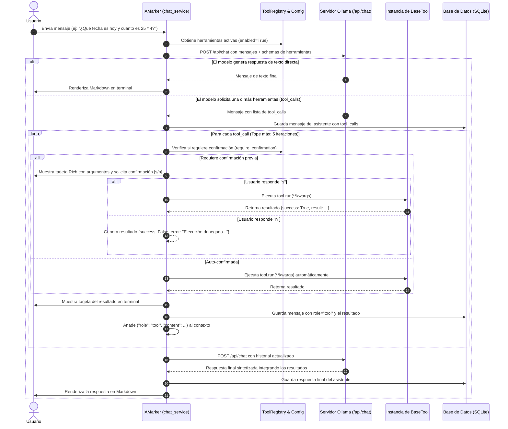

# Sistema de Herramientas (Tools / Function Calling) en IAMarker

Este documento describe la arquitectura, el flujo de ejecución, la configuración y el proceso de creación de nuevas herramientas (**Tools**) en **IAMarker**.

---

## Tabla de Contenidos

1. [Introducción](#-introducción)
2. [Arquitectura y Flujo de Ejecución (Ciclo ReAct)](#-arquitectura-y-flujo-de-ejecución-ciclo-react)
3. [Estructura del Proyecto y Responsabilidades](#-estructura-del-proyecto-y-responsabilidades)
4. [Herramientas Integradas por Defecto](#-herramientas-integradas-por-defecto)
5. [Gestión y Comandos CLI](#-gestión-y-comandos-cli)
6. [Confirmación del Usuario y Seguridad](#-confirmación-del-usuario-y-seguridad)
7. [Persistencia en Base de Datos](#-persistencia-en-base-de-datos)
8. [Guía: Cómo Crear una Nueva Herramienta](#-guía-cómo-crear-una-nueva-herramienta)

---

## Introducción

El sistema de herramientas (**Function Calling**) permite que los modelos de lenguaje compatibles ejecutados en Ollama (como `qwen2.5`, `qwen3.5`, `llama3.1`, `llama3.2`, `mistral`, etc.) puedan solicitar la ejecución de funciones locales de Python para obtener información en tiempo real del sistema, realizar cálculos precisos o ejecutar acciones en el entorno.

### Características Principales:
- **Esquema Estándar OpenAPI/JSON Schema**: Compatible de forma nativa con la API `/api/chat` de Ollama.
- **Arquitectura Modular Aislada**: Cada herramienta se define en su propio archivo dentro de `tools/definitions/`.
- **Soporte Síncrono y Asíncrono**: Las herramientas pueden implementarse con `def execute` o con `async def execute` (`asyncio`).
- **Control On/Off Granular y Global**: Habilita o deshabilita herramientas individualmente o a nivel de todo el sistema.
- **Confirmación Interactiva de Seguridad**: Previene la ejecución de comandos sensibles sin la aprobación explícita del usuario (`[s/n]`).
- **Bucle ReAct con Límite de Iteraciones**: Ejecución encadenada de hasta 5 iteraciones consecutivas para evitar bucles infinitos.
- **Historial y Persistencia**: Guarda llamadas y respuestas de herramientas en SQLite (`database.db`) para reanudación con `resume`.

---

## Arquitectura y Flujo de Ejecución (Ciclo ReAct)

Cuando el usuario realiza una consulta mediante `req`, `chat` o `resume`, IAMarker orquesta el ciclo de herramientas a través de `core/chat_service.py`:



---

## Estructura del Proyecto y Responsabilidades

```text
IAMarker/
├── tools/
│   ├── __init__.py           # Exporta BaseTool, ToolRegistry y la instancia singleton registry
│   ├── base.py               # Clase abstracta BaseTool (esquemas, wrappers y soporte async)
│   ├── registry.py           # Catálogo central, filtros de estado y ejecutor de tools
│   └── definitions/          # Definición de cada herramienta en su propio archivo .py
│       ├── __init__.py       # Exporta las herramientas integradas
│       ├── datetime_tool.py  # Herramienta get_current_datetime
│       ├── calculator_tool.py# Herramienta calculator (AST seguro)
│       ├── read_file_tool.py # Herramienta read_file
│       └── bash_tool.py      # Herramienta execute_bash
├── core/
│   ├── chat_service.py       # Bucle ReAct, inyección de tools y resolución de llamadas
│   └── core_service.py       # Handlers de comandos CLI (tools, enable_tool, etc.)
├── gui/
│   ├── tools_view.py         # Tarjetas visuales Rich para solicitud de confirmación y resultados
│   └── render.py             # Captura de tool_calls en streaming/no-streaming y render de historial
├── persistent/
│   └── db.py                 # Persistencia en SQLite (columna tool_calls y rol 'tool')
└── utils/
    └── helpers.py            # Lectura y persistencia de configuración en config.json
```

---

## 🛠️ Herramientas Integradas por Defecto

| Herramienta | Nombre Interno | Confirmación | Estado por Defecto | Descripción |
| :--- | :--- | :---: | :---: | :--- |
| **Fecha y Hora** | `get_current_datetime` | Automática | Activada | Obtiene la fecha, hora, día de la semana y formato ISO local. |
| **Calculadora** | `calculator` | Automática | Activada | Evalúa operaciones matemáticas de forma segura mediante análisis sintáctico (`ast`), sin usar `eval()`. |
| **Lectura de Archivos** | `read_file` | Requerida  | Desactivada | Lee el contenido de archivos de texto locales con límite de líneas configurable. |
| **Shell Bash** | `execute_bash` | Requerida | Desactivada | Ejecuta comandos en `/bin/bash` con límite de tiempo y captura de `stdout`/`stderr`. |

---

## Gestión y Comandos CLI

Puedes administrar el comportamiento de las herramientas desde la terminal usando los siguientes subcomandos:

### 1. Listar herramientas y estado actual
Muestra una tabla con todas las herramientas registradas, si están activas o inactivas, y su política de confirmación:
```bash
python main.py tools
```

### 2. Activar o desactivar una herramienta específica
```bash
# Desactivar una herramienta
python main.py disable_tool -t execute_bash

# Activar una herramienta
python main.py enable_tool -t execute_bash
```

### 3. Configurar la política de confirmación
Define si una herramienta se ejecutará automáticamente o solicitará aprobación previa en la terminal:
```bash
# Exigir confirmación interactiva [s/n] antes de ejecutar la calculadora
python main.py tool_confirm -t calculator -v true

# Permitir que se ejecute automáticamente sin pausar
python main.py tool_confirm -t calculator -v false
```

### 4. Activar o desactivar las herramientas globalmente
Permite deshabilitar el envío de herramientas a Ollama de forma instantánea sin perder la configuración individual:
```bash
python main.py toggle_tools
```

---

## Confirmación del Usuario y Seguridad

Por seguridad, las herramientas que interactúan directamente con el sistema operativo (como `execute_bash`) o aquellas configuradas con `"require_confirmation": true` detienen el flujo antes de ejecutarse:

1. **Tarjeta de Solicitud**: En consola se presenta un panel estilizado con el nombre de la herramienta y los argumentos exactos enviados por el modelo en formato JSON resaltado con sintaxis oscura:
   ```text
   ╭─ 🛠️  Llamada a Herramienta: execute_bash ─╮
   │ {                                        │
   │   "command": "ls -la /tmp"               │
   │ }                                        │
   ╰───────── Parámetros de ejecución ────────╯
   ¿Deseas permitir la ejecución de esta herramienta? [s/n]: 
   ```
2. **Si el usuario aprueba (`s`)**: La herramienta se ejecuta y su salida se muestra en un panel verde con su respectivo badge.
3. **Si el usuario deniega (`n`)**: La ejecución se cancela de forma controlada y se envía un mensaje de error informativo al modelo (`"Ejecución denegada por el usuario."`), permitiendo que el LLM comprenda la decisión y responda adecuadamente sin interrumpir la conversación.

---

## Persistencia en Base de Datos

En SQLite (`database.db`), la tabla `messages` incluye soporte nativo para el historial de herramientas:
- **`role`**: Permite valores `'user'`, `'assistant'` y `'tool'`.
- **`tool_calls`**: Columna `TEXT` que almacena el JSON con las llamadas generadas por el modelo en ese turno.
- **`content`**: Contiene el texto de respuesta o el resultado serializado de la herramienta.

Al reanudar una sesión previa con `python main.py resume`, IAMarker reconstruye tanto las llamadas como los resultados de herramientas para preservar el contexto completo ante Ollama.

---

## Guía: Cómo Crear una Nueva Herramienta

Cada nueva herramienta debe ubicarse en su propio archivo `.py` dentro de `tools/definitions/`.

### Paso 1: Crear la clase de la herramienta

Crea el archivo `tools/definitions/mi_herramienta_tool.py`:

```python
from typing import Any, Dict
from tools.base import BaseTool

class MiHerramientaTool(BaseTool):
    # 1. Nombre con el que Ollama identificará la función
    name = "mi_herramienta"
    
    # 2. Descripción clara para que el modelo sepa cuándo invocarla
    description = "Descripción detallada de la función y su utilidad."
    
    # 3. Esquema JSON de parámetros (OpenAPI standard)
    parameters = {
        "type": "object",
        "properties": {
            "parametro_uno": {
                "type": "string",
                "description": "Explicación del parámetro."
            },
            "opcional": {
                "type": "integer",
                "description": "Valor numérico opcional."
            }
        },
        "required": ["parametro_uno"]
    }
    
    # 4. Políticas de confirmación y disponibilidad inicial
    require_confirmation = False  # Cambiar a True si realiza acciones sensibles
    enabled_by_default = True

    # 5. Lógica de ejecución (síncrona)
    def execute(self, **kwargs) -> Dict[str, Any]:
        param = kwargs.get("parametro_uno")
        # Tu lógica en Python aquí...
        return {
            "resultado": f"Procesado: {param}"
        }
```

> [!TIP]
> **Soporte para Tareas Asíncronas**:
> Si tu herramienta necesita realizar llamadas HTTP o tareas I/O asíncronas, simplemente define `async def execute(self, **kwargs) -> Dict[str, Any]:`. La clase base `BaseTool` gestionará el bucle de eventos con `asyncio` automáticamente.

### Paso 2: Registrar la herramienta

En `extensions.py`:
```python
from tools.definitions.mi_herramienta_tool import MiHerramientaTool

def init_tools():
    """
    Define tools personalizadas del usuario
    """
    registry.register(mi_herramienta_tool())

```

¡Listo! La herramienta quedará integrada en el catálogo, sincronizada en `config.json` y lista para ser usada por los modelos compatibles en IAMarker.
